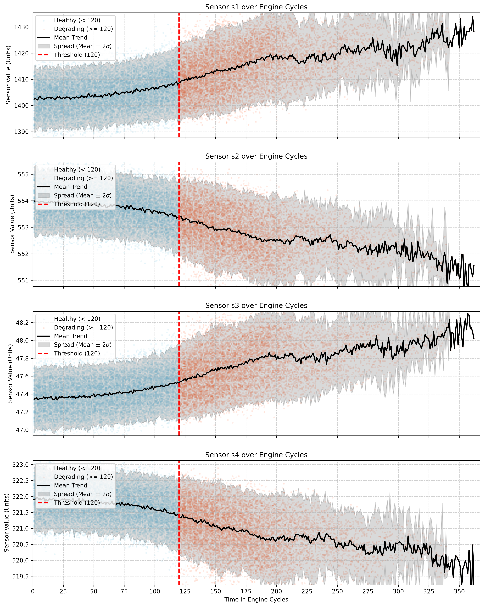
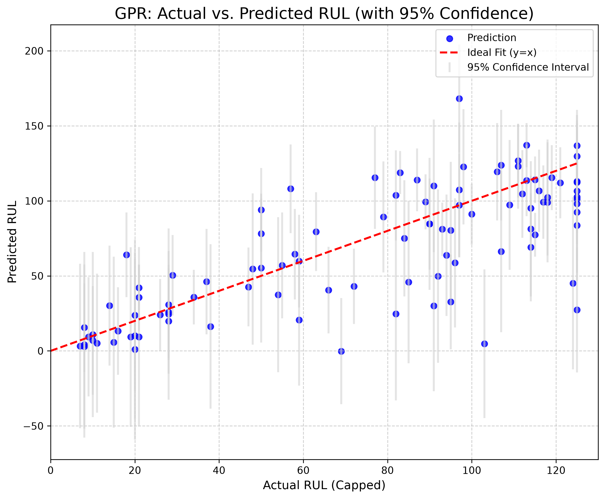
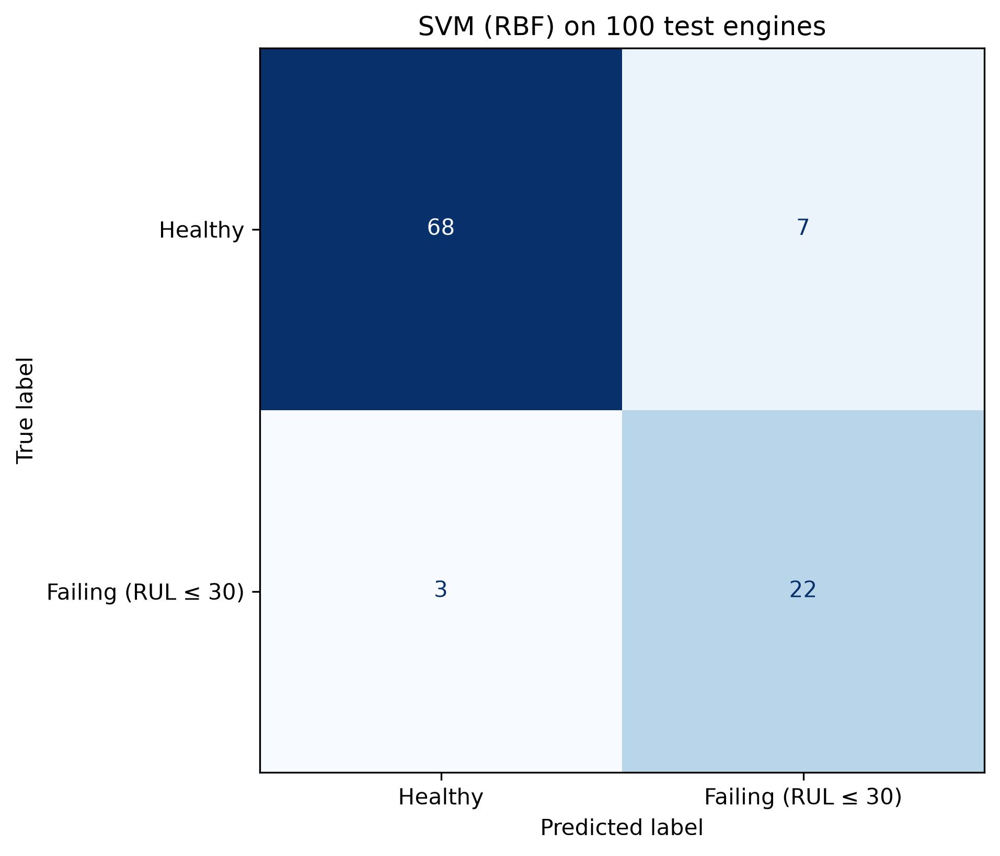

# Predictive maintenance of turbofan engines with statistical learning

The objective of this project is to predict how many cycles an engine has left before failure (**remaining useful life, RUL**) and flag the engines that need maintenance within the next 30 cycles.

**Key results (100 test engines)**
- **SVM classifier** catches **22 of the 25 engines** about to fail (recall 0.88, F1 0.81).
- **Polynomial Ridge regression** gives the most accurate RUL: within **±16 cycles** on average (MAE), R² 0.73.
- **Gaussian Process regression** is less accurate (MAE 21 cycles) but gives an **uncertainty interval** for every engine (nominally 95 %, 79 % in practice: see below).

## Problem and data

The project uses three files, all in `data/`. Train and test are CSV files.

| File | Content | Size |
|---|---|---|
| `train_selected.csv` | Full run-to-failure history of 100 engines, with the corresponding RUL | 20,631 rows (one per engine and cycle) |
| `test_selected.csv` | One snapshot per engine of 100 other engines, **without** the RUL | 100 rows (one per engine) |
| `PM_truth.txt` | True RUL of each test engine, one value per line, in the order of `id` in the test file | 100 values |

**Columns of `test_selected.csv`** (also present in the train file):

| Column | Meaning |
|---|---|
| `id` | Engine identifier (1 to 100). Train and test engines are different engines. |
| `cycle` | Number of cycles the engine has run so far (age of the engine) |
| `s1` to `s4` | Four sensor measurements taken at that cycle |

**`train_selected.csv` has the same six columns plus two targets:**

| Column | Meaning |
|---|---|
| `ttf` | Time to failure: the number of cycles left before the engine fails at that row. It is the RUL. It counts down to 0 at the last row of each engine (e.g. engine 1: `ttf` = 191 at cycle 1, 190 at cycle 2, ..., 0 at its last cycle). |
| `label_bnc` | Binary label for the classification task: `1` if `ttf` ≤ 30 (the engine fails within 30 cycles), `0` otherwise |

In `eda.py` and `gpr_RBF_whitenoise.py`, `ttf` is renamed `RUL` and a capped version `RUL_Capped` (max 125) is added. The notebook caps `ttf` directly.

**How the files are used**
- **Train**: each engine is followed from cycle 1 until it fails, so every row has its RUL. The models learn from these rows.
- **Test**: each engine appears only once, at the last cycle observed before failure. The models predict its RUL and its `label_bnc` from `cycle` and the sensors (see Models for which ones).
- **Truth**: `PM_truth.txt` gives the real RUL of each test engine. It is used only to score the predictions. The real label of the test engines is derived from it (RUL ≤ 30 means failing, which gives the 25 failing / 75 healthy split).

Source: anonymised extract of simulated run-to-failure engine data (Microsoft predictive maintenance template).

## From analysis to decisions



| What the data shows | Decision |
|---|---|
| Sensors stay flat for about 100 cycles, then drift faster and faster (figure above). With the Ridge, a straight line (degree 1) reaches R² 0.66 on the test set, against 0.73 for degree 4: the relation to RUL is not linear. | Non-linear models: polynomial features for Ridge, RBF kernel for GPR and SVM. |
| Sensors remain stable as long as the engines are healthy, so sensor values look the same whether the RUL is 300 or 150 cycles. | RUL capped at 125 cycles for both regression models. The correlation of s3 with the RUL rises from -0.70 to -0.78 ([correlation matrix](figures/correlation_matrix.png)). |
| The four sensors carry almost the same information: similar correlation with the RUL (\|r\| = 0.66 to 0.70) and strongly correlated with each other (\|r\| = 0.79 to 0.85). | Ridge uses two of them (s3, s4) instead of all four. |
| Only 15 % of training rows are "failing within 30 cycles" (printed by `SVMC_grid_res_RBF.py`). | `class_weight="balanced"` for the SVM. Evaluation with recall and F1, not accuracy. |
| The spread between engines peaks around cycle 150, when healthy and near-failure engines run side by side; only 17 of 100 engines reach cycle 250. | GPR, which gives a confidence interval that widens where data is scarce. |

## Models

| Task | Model | Inputs | Tuning |
|---|---|---|---|
| RUL regression | Polynomial regression + **Ridge** | cycle, s3, s4 | degree (1 to 4) chosen by 5-fold cross-validation grouped by engine (`GroupKFold`): degree 4. Alpha chosen by cross-validation (0.01 to 100): alpha = 10 |
| RUL regression | **Gaussian Process** (RBF + white noise kernel) | cycle, s1 to s4 | kernel hyperparameters fitted by maximising the log marginal likelihood, on 2,500 sampled training rows (exact GPR scales as n³) |
| Failure within 30 cycles | **SVM** (RBF kernel), `class_weight="balanced"` | cycle, s1 to s4 | C and gamma tuned with `GridSearchCV` (cross-validation) |

**Why these metrics.** For the RUL, MAE gives the average error in cycles and RMSE penalises the large errors that matter most for maintenance planning. For the failure flag, accuracy would be misleading: only 25 of the 100 test engines are failing, so a model that always says "healthy" scores 75 %. Recall (missed failures) comes first, F1 balances it with false alarms.

## Results

| Model | R² | MAE (cycles) | RMSE (cycles) |
|---|---|---|---|
| Polynomial Ridge (degree 4) | **0.73** | **16.0** | **20.7** |
| Gaussian Process | 0.46 | 21.0 | 29.4 |

Both models are trained and scored on the RUL capped at 125. The Ridge gives the better point prediction; the Gaussian Process is kept for its intervals, which show the maintenance team which predictions to trust less, even if they are too narrow (see below).



The column of points at RUL = 125 are healthy engines, where the capped target gives the model the least signal. Intervals widen where training data is scarce.

| SVM, class "failing" | Precision | Recall | F1 |
|---|---|---|---|
| Test set (25 failing / 75 healthy) | 0.76 | **0.88** | 0.81 |



## What I would do differently

**Assumptions I would challenge**
- **The SVM is tuned on the wrong metric and the wrong split.** `GridSearchCV` uses its default score, accuracy, which this README calls misleading, and splits folds by row, so rows of the same engine end up on both sides. I would tune it with `GroupKFold` by engine and `scoring="recall"` or `"f1"`, as done for the Ridge degree.
- **The GPR intervals are not reliable 95 % intervals.** They contain the true RUL for only 79 of the 100 test engines, and 31 of them go below 0, which a RUL never does. The GPR was fitted on 2,500 rows sampled out of 20,631; a larger sample, or a sparse GP, should give better calibrated intervals.
- **Some choices were never tested.** The cap of 125 cycles, the two sensors (s3, s4) used by the Ridge, and the polynomial degree, where degree 4 is the edge of the tested range. I would compare caps of 100, 125 and 150, all four sensors, and degrees above 4, with the same grouped cross-validation.

**What I would try next**
- **Trend features**: each engine is a time series, but the models only see one cycle at a time. The slope and mean of each sensor over the last 10 to 20 cycles would show how fast an engine is degrading, not only where it stands.
- **Gradient boosting (XGBoost)** with SHAP values, to compare with the Ridge and to see which sensors and trends drive each prediction.

## Repository

| File | Role |
|---|---|
| `eda.py` | Data cleaning, RUL capping, sensor degradation plots, correlation matrix |
| `poly2multi_ridge.ipynb` | Polynomial Ridge regression of the RUL, degree chosen by cross-validation |
| `gpr_RBF_whitenoise.py` | Gaussian Process regression with 95 % intervals |
| `SVMC_grid_res_RBF.py` | SVM classifier (failing within 30 cycles) |
| `data/` | Train, test and true RUL files |
| `figures/` | All saved plots (shown or linked above) |

## Run it

```bash
pip install -r requirements.txt
python eda.py
python SVMC_grid_res_RBF.py
python gpr_RBF_whitenoise.py   # slower: Gaussian Process on 2,500 points
```

The Ridge regression is in `poly2multi_ridge.ipynb`: open it in Jupyter or VS Code and run all cells.
